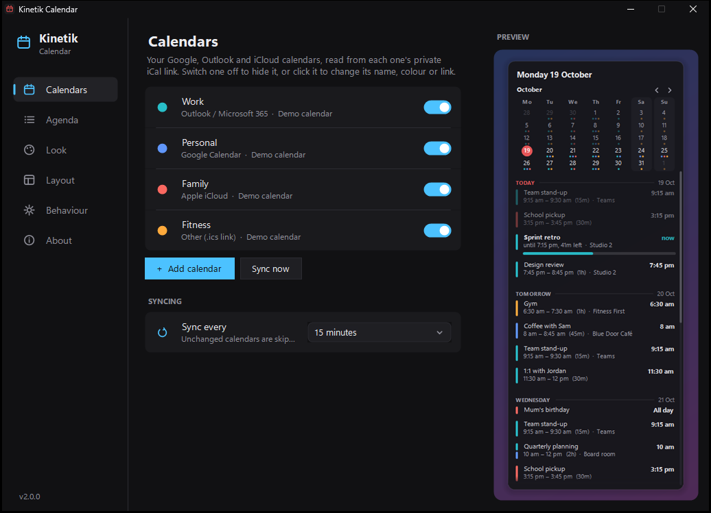
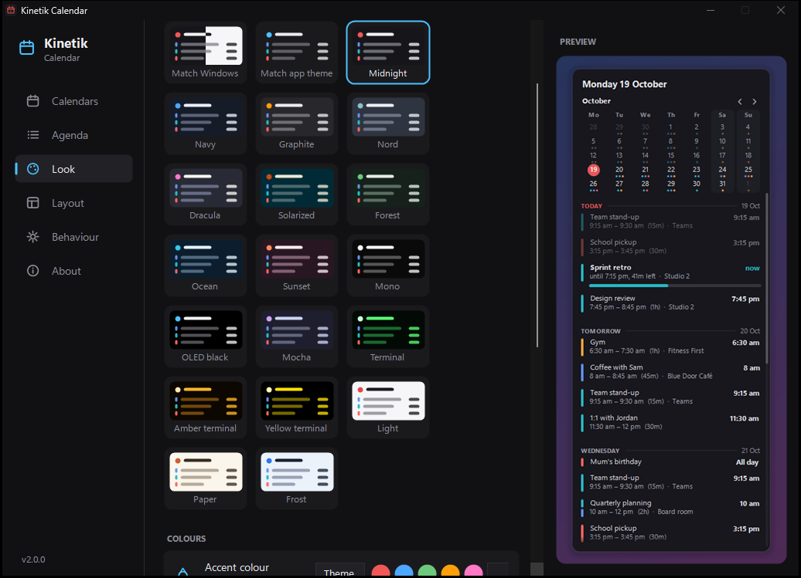
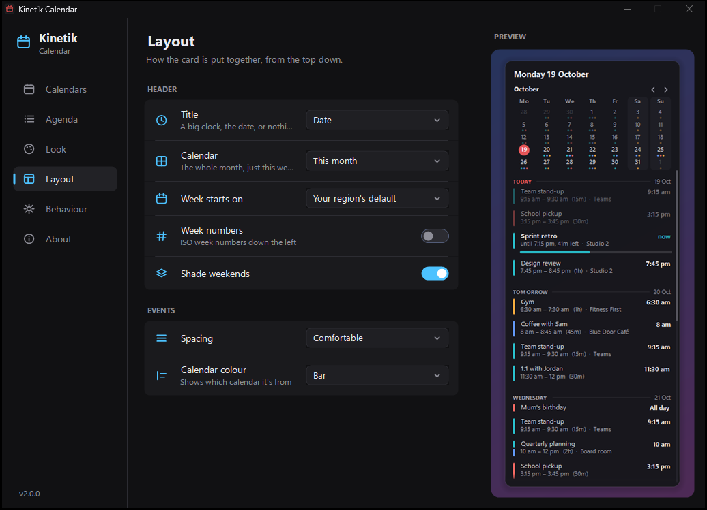
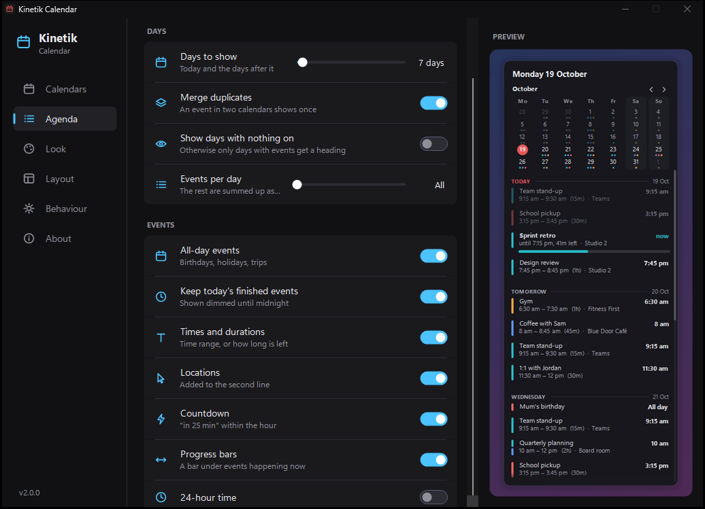
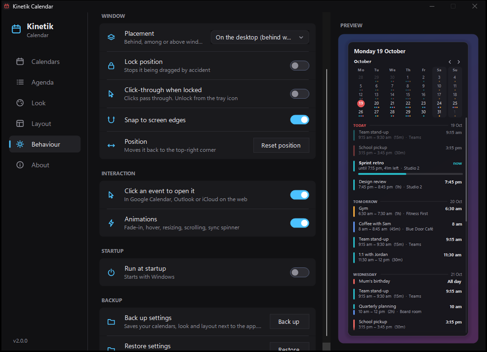

# Kinetik Calendar: Google, Outlook and iCloud calendar widget for the Windows desktop

[](../../releases/latest)
[](../../releases)
[](LICENSE)


**Kinetik Calendar** is a free, open-source **desktop calendar widget for Windows 11 and Windows 10**. It puts your **Google Calendar**, **Outlook / Microsoft 365 calendar** and **Apple iCloud calendar** together on your desktop: a month view with a dot on every busy day, and an agenda of what's coming up, with countdowns and progress bars for what's happening now.

There's no sign-in and no API key. Each calendar is read from its private iCal (`.ics`) subscription link, so it works with almost any calendar app. It's a small portable app with no installer, about 13 MB in memory and no measurable CPU use while idle. It's the calendar companion to [Kinetik](https://github.com/WastedDesigner/Kinetik), the taskbar system monitor, and shares its look.


> **About this project:** I made this for my own desktop and decided to share it in case anyone else finds it useful. If you run into a bug or have an idea for a feature, please [open an issue](../../issues).

**Latest version: v1.1.4.** [Download it from Releases](../../releases/latest).

## Contents

- [Features](#features)
- [Themes and layouts](#themes-and-layouts)
- [Download and use](#download-and-use)
- [Adding your calendars](#adding-your-calendars)
- [Settings guide](#settings-guide)
- [Privacy](#privacy)
- [Light on resources](#light-on-resources)
- [FAQ](#faq)
- [Requirements](#requirements)
- [Known limitations](#known-limitations)
- [Building from source](#building-from-source)
- [License](#license)

## Features

- **Every calendar in one place:** Google Calendar, Outlook.com, Microsoft 365 / Office 365, Apple iCloud, and any other calendar with an iCal / ICS / webcal link (Proton, Fastmail, Zoho, Nextcloud, school timetables, sports fixtures, public holidays)
- **Month or week view** with coloured dots on each day that has events, and today highlighted
- **Agenda** for 1 to 31 days ahead, grouped under Today, Tomorrow and each weekday
- **Live status:** events happening now show **now**, the time left and a progress bar. Events within the hour count down: **in 25 min**
- **Duplicates merged:** a meeting that's in both your work and personal calendars shows once, marked in both colours
- **Click an event** to open that day in Google Calendar, Outlook on the web or iCloud
- **Recurring events** handled properly: daily, weekly, monthly and yearly rules, "last Friday of the month", exceptions, moved and cancelled occurrences, and time zones
- **Works offline:** the last copy of each calendar is kept, so the widget fills in instantly at startup and keeps working without internet
- **Desktop placement:** behind your windows (like a desktop gadget), as a normal window, or always on top. Drag it anywhere. It snaps to screen edges, remembers its position, and can be locked or made click-through
- **Smooth animations:** fade-in, rows rising into place, hover highlights, smooth resizing and scrolling, a sync spinner, and a glint on the progress bar. They run only while something is moving, and can be switched off
- **Sharp text:** ClearType rendering on the semi-transparent card
- **Tray icon** and right-click menu: Sync now, Open calendar, Settings, Themes, Lock position, Exit
- **Portable:** a single exe, no installer, optional run at startup

## Themes and layouts

13 built-in themes plus **Match Windows**, which follows Windows' light or dark mode: Midnight, Navy, Graphite, Nord, Dracula, Solarized, Forest, Ocean, Sunset, Mono, Light, Paper and Frost. Pick your own accent and background colours on top of any theme.


Make it yours:

- **Title:** the date, a big clock with the date, or nothing
- **Calendar:** this month, this week, or hidden, with optional week numbers, weekend shading and any first day of the week
- **Event markers:** a coloured bar, a dot, a tinted card, or none
- **Spacing:** compact, comfortable or roomy
- **Font, size, width, background opacity, text opacity, corner roundness, shadow and outline**
- **What's listed:** all-day events, finished events, empty days, events per day, times, durations, locations, countdowns and progress bars, 12 or 24-hour time

<br clear="right">

## Download and use

1. Download `KinetikCalendar.zip` from the [Releases](../../releases/latest) page and extract it anywhere.
2. Run `KinetikCalendar.exe`. Settings opens the first time.
3. Click **+ Add calendar**, paste a calendar's iCal link, pick a colour and click **Test link**. The widget appears in the top-right corner of your screen.

Want to look around first? Run `KinetikCalendar.exe --demo` to try it with made-up calendars. Demo mode doesn't read or save anything on your PC.

Windows SmartScreen may warn you because the exe isn't code-signed. Click **More info → Run anyway**.

## Adding your calendars

Each calendar has a private address that calendar apps can subscribe to. Copy it once and paste it into Kinetik Calendar.

| Calendar | Where to find the link |
|---|---|
| **Google Calendar** | [calendar.google.com](https://calendar.google.com) → Settings (gear) → pick the calendar under *Settings for my calendars* → **Integrate calendar** → copy **Secret address in iCal format** |
| **Outlook.com / Microsoft 365** | [outlook.com](https://outlook.live.com/calendar) or [outlook.office.com](https://outlook.office.com/calendar) → Settings → Calendar → **Shared calendars** → **Publish a calendar** → choose *Can view all details* → copy the **ICS** link |
| **Apple iCloud** | iPhone or iPad: Calendar → Calendars → (i) next to the calendar → turn on **Public Calendar** → Share Link. Mac: right-click the calendar → Share Calendar → **Public Calendar** → copy the `webcal://` link |
| **Anything else** | Any `https://` or `webcal://` link to an `.ics` file |

Add each calendar you want (work, personal, family, holidays). Each gets its own colour.



## Settings guide

Right-click the widget or click the tray icon for **Settings**. Every change shows straight away in the live preview.

| Page | What's on it |
|---|---|
| **Calendars** | Each calendar with its colour and sync status. Switch one off, or click it to rename, recolour, change the link or remove it. Sync interval (5 minutes to 1 hour) |
| **Agenda** | Days to show, merge duplicates, empty days, events per day, all-day events, today's finished events, times and durations, locations, countdown, progress bars, 24-hour time |
| **Look** | Theme gallery, accent and background colour, font, size, width, background opacity, corner roundness, shadow, outline, restore default look |
| **Layout** | Title style, month / week / hidden calendar, first day of the week, week numbers, weekend shading, spacing, event marker style |
| **Behaviour** | Placement, lock position, click-through, snap to edges, reset position, click to open, animations, run at startup |
| **About** | Version, memory in use, and where data is kept |

<table>
<tr><td width="50%" valign="top"><br><sub><b>Look</b></sub></td><td width="50%" valign="top"><br><sub><b>Layout</b></sub></td></tr>
<tr><td width="50%" valign="top"><br><sub><b>Agenda</b></sub></td><td width="50%" valign="top"><br><sub><b>Behaviour</b></sub></td></tr>
</table>

## Privacy

- Kinetik Calendar only **reads** your calendars. It can't create, change or delete events.
- It talks only to the calendar links you add. There's no account, telemetry, analytics or third-party server.
- Calendar links and settings are stored in your Windows user registry (`HKCU\Software\KinetikCalendar`), and the offline copies in `%LOCALAPPDATA%\KinetikCalendar`. Nothing is written next to the exe, so a synced or shared folder never contains your links.
- Treat the links like passwords: anyone who has one can read that calendar. If one leaks, reset it in your calendar's settings (Google has a **Reset** button next to the secret address) and paste the new one.

## Light on resources

About 13 MB of memory in use, and no measurable CPU between updates.

- Wakes once a minute, on the minute, and redraws only when something on the card has changed
- Does nothing while the PC is locked, and catches up when you unlock
- Calendars that haven't changed aren't downloaded again (HTTP ETag / Last-Modified) or re-read (content hash)
- Keeps only what the widget shows from each event: no descriptions or attendee lists
- Gives unused memory back to Windows after startup, after each sync and after closing Settings

## FAQ

**How do I put Google Calendar on my Windows desktop?**
Install Kinetik Calendar, copy your Google Calendar's *Secret address in iCal format* (Settings → your calendar → Integrate calendar), and paste it into **+ Add calendar**. Your events appear on the desktop and update every 15 minutes.

**Can I see my Outlook calendar on the desktop without opening Outlook?**
Yes. Publish the calendar from Outlook on the web (Settings → Calendar → Shared calendars → Publish a calendar) and add the ICS link. It works with Outlook.com and Microsoft 365 / Office 365, unless your organisation has turned publishing off.

**Does it work with iCloud calendars on Windows?**
Yes. Make the calendar public in the Calendar app on your iPhone, iPad or Mac and add its `webcal://` link. You don't need iCloud for Windows.

**Can it show Google, Outlook and iCloud calendars together?**
Yes. Add as many calendars as you like from any mix of providers. Each has its own colour, and events that are in more than one calendar show once.

**Is it a replacement for the old Windows 7 desktop gadgets or Rainmeter calendar skins?**
That's what it's for: a calendar that lives on the desktop behind your windows, with no Rainmeter, no scripting and no setup beyond pasting links.

**Why aren't new events showing up straight away?**
Google and Microsoft refresh published calendar links on their own schedule, from a few minutes up to a few hours. Kinetik Calendar checks every 15 minutes by default. Right-click → **Sync now** checks immediately.

**Can I add or edit events from the widget?**
No. It's read-only by design. Click an event to open it in Google Calendar, Outlook or iCloud on the web.

## Requirements

- Windows 10 or 11 (64-bit)
- .NET Framework 4.7.2 or later (already part of Windows 10 and 11)

## Known limitations

- New events take as long to appear as the provider takes to update its published link (see the [FAQ](#faq)).
- Some work or school Microsoft 365 accounts have calendar publishing turned off by IT.
- Rare recurrence rules (BYWEEKNO, BYYEARDAY, RDATE) aren't expanded. Everything Google, Outlook and iCloud normally produce is.
- In **On the desktop** placement, Windows' Show desktop (Win+D) may hide the widget. Use **Always on top** if that bothers you.

## Building from source

No Visual Studio or SDK needed. It compiles with the .NET Framework compiler that's built into Windows.

```bat
build.bat
```

This produces `KinetikCalendar.exe` with the app icon embedded (`make-icon.ps1` draws `icon.ico` if it's missing). `build.bat package` also makes `KinetikCalendar.zip` for a release. Everything is in one file, `KinetikCalendar.cs`.

## Version history

See [RELEASE_NOTES.md](RELEASE_NOTES.md).

## Tests and packaging

`python tests/run-tests.py` runs the regression checks (no window opens). `build.bat package` builds the exe and makes the release zip, checking every file in it against its SHA-256 hash. The shared support code (`SuiteSupport.cs`) is compiled into the exe, so there's no extra DLL.

## License

Copyright © 2026 Akila Sella Hennedige.

Released under the [GNU General Public License v3.0](LICENSE) (GPL-3.0-or-later). You're free to use, study, modify and share it, including commercially, as long as anything you distribute that's based on it is also released under the GPL with its source code available.
